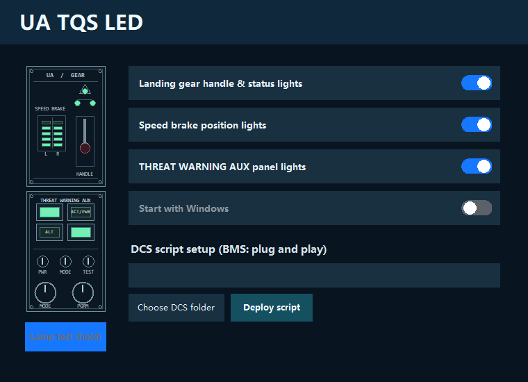

# UA TQS LED 1.0.0

UA TQS LED drives the lamps on a Thrustmaster Viper TQS Mission Pack / Panel from live DCS F-16C or Falcon BMS 4.38 data. It automatically selects the game currently providing data. The application is independent of T.A.R.G.E.T. and Union Avionics software.

This is an independent community utility. It is not made, endorsed, or supported by Thrustmaster, Eagle Dynamics, or Benchmark Sims.

## Requirements

- A Windows x64 PC with one connected Viper TQS.
- DCS World with the F-16C module, Falcon BMS 4.38, or both.
- Permission to write to your chosen application folder and, for DCS integration, the relevant `Saved Games/DCS.../Scripts` folder.

## Install

1. Connect the Viper TQS and check that Windows recognizes it.
2. Download `UA-TQS-LED-Setup-v1.0.0-Windows-x64.exe` from the [latest release](https://github.com/ST0532/ua-tqs-led/releases/latest), then run it and choose an installation folder.
3. If one DCS Saved Games profile is detected, setup deploys its export script. If multiple profiles are detected, choose the intended one. If none is detected, setup installs the BMS direct-read mode without a DCS script.
4. Start **UA TQS LED** using the desktop shortcut. Its three switches control landing gear, speed brake, and THREAT WARNING AUX lamps. Hold **Lamp test (hold)** to light the lamps; releasing it restores live game output.

The installer creates a separate version folder, a desktop shortcut, and a current-user Windows startup entry. DCS deployment adds a marked hook to `Export.lua` and creates a backup before changing an existing file. The application's DCS setup controls can select a profile and redeploy the hook later. Falcon BMS needs no script deployment.

## Scope and limitations

- DCS integration targets the F-16C module. Falcon BMS integration targets the 4.38 shared-memory layout.
- The package is unsigned. Windows may display a publisher warning.
- This is a test release. Results may vary across systems; if you encounter a problem, please [open an issue](https://github.com/ST0532/ua-tqs-led/issues/new) with steps to reproduce.
- The GitHub release contains the Windows installer; this repository contains documentation and third-party notices. Application source code is not published here.

Verify the downloaded installer against `SHA256SUMS.txt`. See `THIRD_PARTY_NOTICES.md` and `licenses/` for bundled third-party components.
